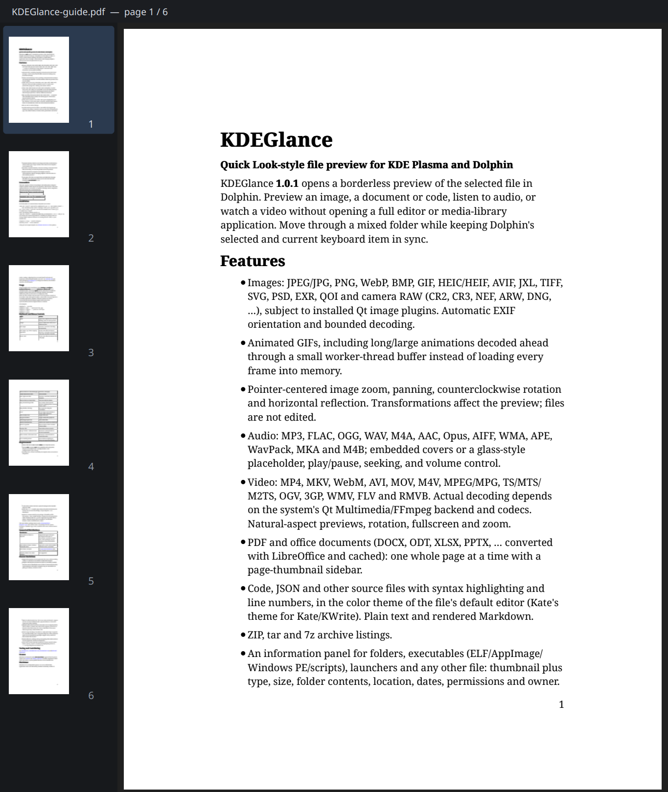
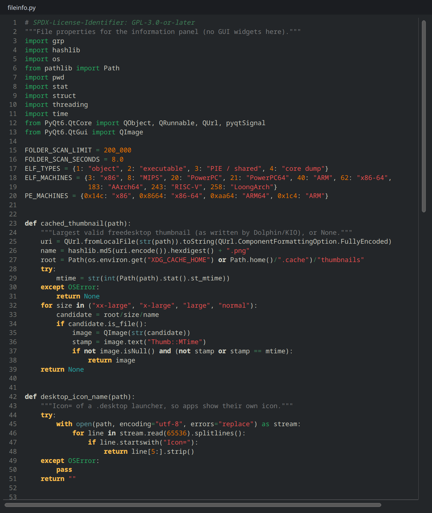
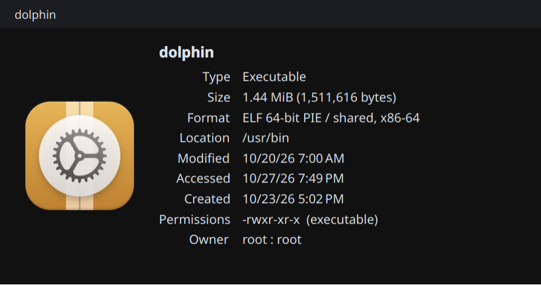
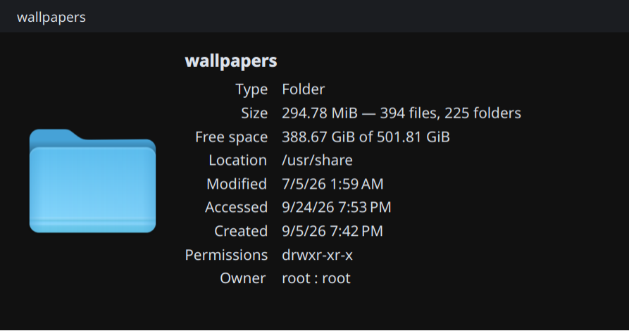
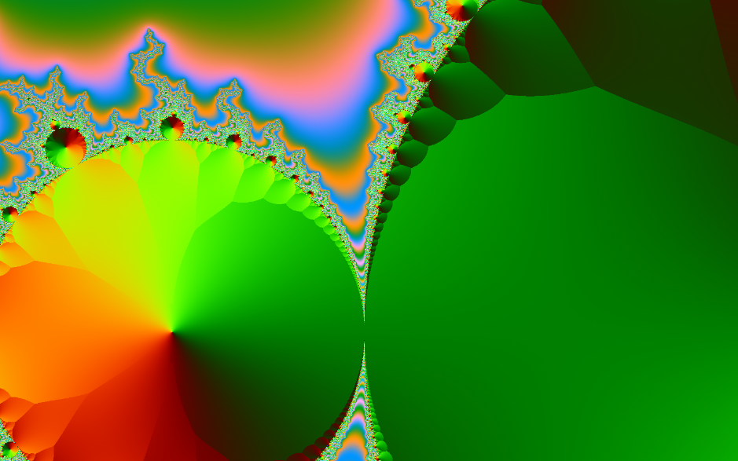
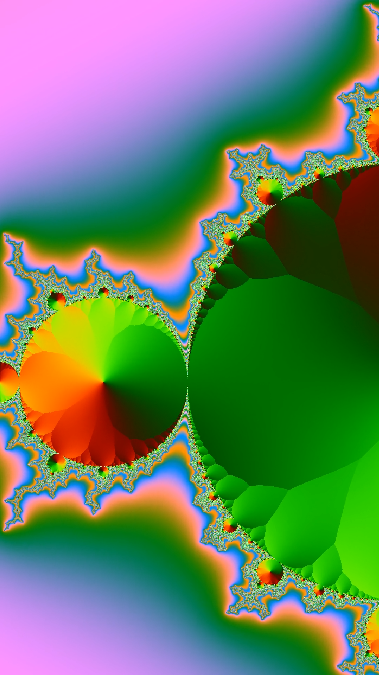

> [!IMPORTANT]
> **This is an unofficial Fedora KDE port of [KDEGlance](https://github.com/AlexGraveler/KDEGlance)
> by AlexGraveler.** It is not affiliated with or endorsed by the original author.
> Please report problems with this port here, not upstream.
>
> **Modified work notice (GPL-3.0-or-later, section 5a):** modified in October 2026
> from upstream v1.0.1. The changes were written with AI
> assistance (Claude). Upstream history and authorship are preserved in the git log.
>
> Changes in this port:
> - Fedora RPM packaging in [packaging/fedora](packaging/fedora) — see
>   [FEDORA-INSTALL.md](packaging/fedora/FEDORA-INSTALL.md).
> - Previews for PDF and office documents (page-thumbnail sidebar, Up/Down
>   turn pages, Left/Right change file), text/code/JSON/Markdown, and archive listings.
> - An information panel (thumbnail and properties) for folders, executables and
>   any other file; the Dolphin action is offered for every file and folder.
> - More image and audio formats; syntax-highlighted code previews.
> - Centered windows fitted to each image and video, sized from Dolphin's window.
> - English messages throughout.
>
> The README below is upstream's, adapted for this port. The original is in the
> [upstream repository](https://github.com/AlexGraveler/KDEGlance).

# KDEGlance

**Quick Look-style file preview for KDE Plasma and Dolphin**

KDEGlance **1.0.1** opens a borderless preview of the selected file in Dolphin.
Preview an image, a document or code, listen to audio, or watch a video without
opening a full editor or media-library application. Move through a mixed folder while keeping
Dolphin's selected and current keyboard item in sync.

## Features

- Images: JPEG/JPG, PNG, WebP, BMP, GIF, HEIC/HEIF, AVIF, JXL, TIFF, SVG, PSD,
  EXR, QOI and camera RAW (CR2, CR3, NEF, ARW, DNG, …), subject to installed Qt
  image plugins. Automatic EXIF orientation and bounded decoding.
- Animated GIFs, including long/large animations decoded ahead through a small
  worker-thread buffer instead of loading every frame into memory.
- Pointer-centered image zoom, panning, counterclockwise rotation and horizontal
  reflection. Transformations affect the preview; files are not edited.
- Audio: MP3, FLAC, OGG, WAV, M4A, AAC, Opus, AIFF, WMA, APE, WavPack, MKA and
  M4B; embedded covers or a glass-style placeholder, play/pause, seeking, and
  volume control.
- Video: MP4, MKV, WebM, AVI, MOV, M4V, MPEG/MPG, TS/MTS/M2TS, OGV, 3GP,
  WMV, FLV and RMVB. Actual decoding depends on the system's Qt Multimedia/FFmpeg
  backend and codecs. Natural-aspect previews, rotation, fullscreen and zoom.
- PDF and office documents (DOCX, ODT, XLSX, PPTX, … converted with LibreOffice
  and cached): one whole page at a time with a page-thumbnail sidebar.
- Code, JSON and other source files with syntax highlighting and line numbers,
  in the color theme of the file's default editor (Kate's theme for Kate/KWrite).
  Plain text and rendered Markdown.
- ZIP, tar and 7z archive listings.
- An information panel for folders, executables (ELF/AppImage/Windows PE/scripts),
  launchers and any other file: thumbnail plus type, size, folder contents,
  location, dates, permissions and owner.
- Centered windows fitted to each image and video (no black bars); vertical videos
  get a larger window. Sizes derive from Dolphin's saved window size.
- Frameless movable windows, focus-loss closing, and controls that fade on
  inactivity or when the pointer leaves the preview.
- Explicit mixed-file navigation and Dolphin selection synchronization. Merely
  changing Dolphin's selection does not start another preview.
- Local paths, file URLs, mounted drives and SMB URLs through KDE KIO Fuse.
  General AFC/iPhone, SFTP and other KIO URL handling is **not included** in 1.0.1.

## Screenshots

### This port

Captured from the real preview windows in a Fedora-based Plasma 6 Wayland session,
with KWin's placement and this port's window sizing. Only generated sample media,
the project's own files and system files were used; see
[screenshots/README.md](screenshots/README.md).

| PDF with page sidebar | Code with syntax colors |
| --- | --- |
|  |  |

| Executable | Folder |
| --- | --- |
|  |  |

| Image in a window fitted to its shape | Vertical video |
| --- | --- |
|  |  |

### Upstream 1.0.1

These are captures of the real Qt widgets and media player, using the original
synthetic media kept in the repository with the tests. They were captured offscreen, not drawn
as interface mockups; native compositor effects/placement are not demonstrated.

| Image preview | Image controls and zoom |
| --- | --- |
|  |  |

| Embedded audio cover | No embedded cover |
| --- | --- |
|  |  |


## Installation

On Fedora KDE, in a normal Plasma Wayland user session:

```bash
sudo dnf install rpm-build rpmdevtools gcc-c++ qt6-qtbase-devel \
    kf6-kwindowsystem-devel desktop-file-utils python3 git
git clone https://github.com/Khalfred/KDEGlance-fedora.git
cd KDEGlance-fedora
bash packaging/fedora/build.sh
sudo dnf install ~/rpmbuild/RPMS/x86_64/kdeglance-1.0.1-*.x86_64.rpm
```

On Fedora 44 you can skip the build: download the RPM from the
[latest release](https://github.com/Khalfred/KDEGlance-fedora/releases/latest) and
run `sudo dnf install ./kdeglance-*.x86_64.rpm`.

`dnf` installs the runtime dependencies. Installing the package does not change
HOME, keyboard shortcuts or running services. Then, as your normal user:

```bash
kdeglance-setup --enable-dolphin
kbuildsycoca6 --noincremental
```

Fully quit and reopen Dolphin. See
[FEDORA-INSTALL.md](packaging/fedora/FEDORA-INSTALL.md) for updates, codecs,
settings, migrating from a manual install, and removal.

To update a source install, pull and rebuild, then install the exact new file
(older builds stay in `~/rpmbuild/RPMS`, so a `*` pattern would match them too):

```bash
cd KDEGlance-fedora
git pull
bash packaging/fedora/build.sh   # lists the built RPMs; the highest release is the new one
sudo dnf install ~/rpmbuild/RPMS/x86_64/kdeglance-<version>-<release>.x86_64.rpm
systemctl --user restart kdeglance2.service
```

A GitHub "Download ZIP" cannot be built: `build.sh` packages the git checkout,
so use `git clone`.

Upstream's Arch/CachyOS installer (`install.sh`, [INSTALL.md](INSTALL.md)) and
Arch packaging ([packaging/aur](packaging/aur)) are kept for reference; the
installer refuses to run on Fedora.

## Usage

Reopen Dolphin after installation. Open **Settings → Configure Keyboard Shortcuts**,
search for **KDEGlance: Quick Look** (or its translated name), and assign **Space**.
Review any shortcut conflict in Dolphin's dialog rather than overwriting it blindly.
The installer deliberately does not edit shortcut configuration files.

Select any file or folder and press Space. Use the preview controls or arrow keys.
Close with Space, Escape, a center click, or by moving focus to another application.
Dolphin's selection remains on the last successfully previewed image/accepted media
item when synchronization with the original folder is available.

CLI examples:

```bash
kdeglance --version
kdeglance open -- /path/to/file.jpg
kdeglance toggle -- /path/to/file.mp3
kdeglance close
kdeglance state
```

## Keyboard and Mouse Controls

| Input | Action |
| --- | --- |
| Space | Open from Dolphin after manual binding; close an active preview |
| Escape | Close; in fullscreen video, leave fullscreen first |
| Left / Right | Previous / next item, including mixed media |
| Up / Down, PageUp / PageDown | In PDF and office documents: previous / next page; past the first / last page, previous / next file |
| Up / Down | In text, code and Markdown: scroll three lines, or previous / next file when it fits without scrolling; in images, video, audio and information panels: previous / next file |
| Home / End | In PDF and office documents: first / last page |
| Mouse wheel on a document page | Previous / next page |
| Center image/cover click | Close preview |
| Left / right area click | Previous / next item (outside the controls) |
| Mouse wheel on image/video | Zoom around the pointer |
| Drag zoomed image/video | Pan content; fitted content/window dragging follows existing viewer rules |
| Drag window; Alt-drag | Move preview using the compositor |
| 0 or F | Fit an image to the window; F toggles video fullscreen |
| Video double click | Toggle fullscreen |
| Play/pause button | Toggle audio/video playback |
| Click/drag progress bar | Seek audio/video |
| Wheel on progress bar | Seek by one second per wheel step |
| Wheel on speaker | Adjust volume; show transient vertical slider |
| Speaker click | Show/hide volume controls |
| Image rotation / reflection icons | Rotate 90° counterclockwise / mirror horizontally |
| Video rotation / fullscreen icons | Rotate 90° counterclockwise / toggle fullscreen |
| Focus outside preview | Close without requiring an always-on-top/modal window |

## Requirements

- Fedora KDE (Plasma **6**, Dolphin **24.02+**) in a Wayland session.
- Python **3.10+**, PyQt6/Qt **6.8+** with Qt Multimedia and Qt PDF, image-format
  plugins (`qt6-qtimageformats`, `kf6-kimageformats`, `qt6-qtsvg`).
- PyGObject/Gio, AT-SPI accessibility for Dolphin order/current-item integration.
- A user D-Bus session and user systemd manager; KIO Fuse/KIO extras for SMB.
- Build only: a C++ compiler, pkg-config and Qt/KF6 WindowSystem headers for the
  activation bridge. No precompiled `.so` is distributed.
- Optional, recommended by the package: LibreOffice (office documents), 7-Zip
  (7z/RAR listings), `ffprobe` from FFmpeg (fitted video windows) and
  `kf6-syntax-highlighting` (code colors). Fedora's default FFmpeg lacks
  H.264/HEVC; see FEDORA-INSTALL.md for the RPM Fusion codecs.

The exact Fedora package names are in
[packaging/fedora/kdeglance.spec](packaging/fedora/kdeglance.spec); `dnf` resolves
them. The package uses the system Mutagen; a bundled copy (1.48.1) remains in the
source with its license notices.

## Supported Distributions

| Distribution | Status |
| --- | --- |
| Fedora KDE 44, Plasma 6 / Wayland | Supported target of this port. Developed and tested on Ultramarine 44 (Fedora 44 KDE base, same packages); not yet tested on a clean stock Fedora install |
| Other Fedora releases / Fedora-based KDE spins | Expected to work with the RPM if Qt/PyQt are 6.8+; not tested |
| Arch Linux / CachyOS | Use [upstream KDEGlance](https://github.com/AlexGraveler/KDEGlance); this port's changes are not tested there |
| Kubuntu, Plasma X11, other desktops | Not supported |

## Known Limitations

- Supported extensions do not guarantee that every codec/encoding variant is
  available in the installed multimedia backend.
- Dolphin order/keyboard selection needs its accessibility-enabled launcher and
  an identifiable source folder. If communication fails, synchronization and
  media navigation may be unavailable. No polling of arbitrary selection occurs.
  When two Dolphin windows show the same folder with the same file selected,
  arrow keys follow their shared order but Dolphin's selection is left unchanged.
- SMB is handled by KIO Fuse. This is not universal KIO/AFC support and has not
  been validated with a physical iPhone. A slow Fuse request may delay opening.
- Wayland placement and screen constraints are managed by KWin, which centers a
  window only when it first appears; previews are therefore sized before they are
  shown. HEIC/HEIF and camera RAW images keep a fixed window size.
- Initial image decoding is bounded to a 4096-pixel edge. Large GIFs use a bounded
  buffer; slow storage/decoding may reduce playback speed. Not all installed
  image plugins support every variant of their nominal file formats.
- Playlists/libraries, editing/saving, and opening files inside archives are not
  supported; archives are listed only.
- Code colors cannot reproduce JetBrains or other non-KDE editor themes exactly;
  choose a close KSyntaxHighlighting theme in `~/.config/kdeglance2/window.ini`.

## Testing and Contributing

See [TESTING.md](TESTING.md), [CONTRIBUTING.md](CONTRIBUTING.md),
[CHANGELOG.md](CHANGELOG.md), and [RELEASE-NOTES.md](RELEASE-NOTES.md).

## License

KDEGlance is licensed under **GPL-3.0-or-later**, approved by the project owner.
See [LICENSE](LICENSE) and [THIRD_PARTY.md](THIRD_PARTY.md). Bundled components
retain their own notices; system Qt/KDE libraries are not bundled here.

## Disclaimer

KDEGlance is an independent project. It is not an official KDE application and
is not endorsed by the KDE community or KDE e.V.
